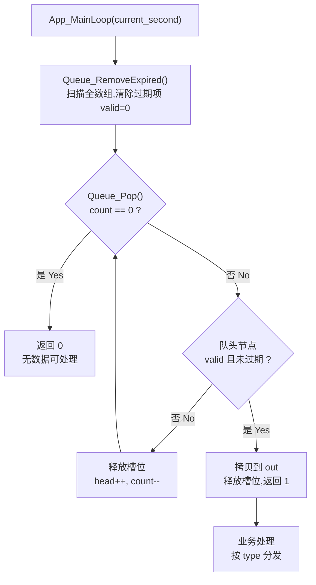

# Queue — 固定大小循环队列模块 / Fixed-Size Circular Queue with Per-Item Timeout

> 本文档为中英双语,每个章节均以「中文 / English」并列呈现,便于在国内团队与开源社区之间共享同一份 API 契约。  
> This document is bilingual — every section presents 中文 and English side by side, so the same API contract can be shared between a domestic team and the open-source community.

一个面向嵌入式 C 的**零动态内存**环形队列模块:在固定数组上实现先进先出,并为**每个队列项**提供独立的超时失效机制。适合串口消息重发、PID 控制指令、加热控制任务等"带超时的命令投递"场景。

A **zero dynamic-allocation** circular queue module for embedded C: FIFO ordering on top of a fixed  
array, with an **independent timeout per item**. Designed for command dispatch with expiry — UART  
retry queues, PID setpoints, heating-control jobs, and similar "deliver-with-deadline" workloads.

---

## 目录 / Table of Contents

- [核心特性](#核心特性--key-features)
- [设计说明](#设计说明--design)
- [数据结构](#数据结构--data-structures)
- [API 参考](#api-参考--api-reference)
- [使用示例](#使用示例--usage-example)
- [移植与集成](#移植与集成--porting--integration)
- [注意事项](#注意事项--caveats)
- [作者与许可](#作者与许可--author--license)

---

## 核心特性 / Key Features

|                     | 中文                                                             | English                                                                                                          |
| ------------------- | ---------------------------------------------------------------- | ---------------------------------------------------------------------------------------------------------------- |
| **静态分配**        | 全部存储在调用方提供的 `Queue_t` 中,无 `malloc` / 无块分配器依赖 | Fully static: all storage lives in the caller-provided `Queue_t`; no `malloc`, no allocator dependency           |
| **每项超时**        | 每个节点独立记录 `start_time` / `expire_time`,过期即自动丢弃     | Per-item TTL: each node carries its own `start_time` / `expire_time` and is dropped once expired                 |
| **回绕安全**        | 过期判断使用无符号减法,秒计数器溢出回绕时依然正确                | Wrap-around safe: expiry uses unsigned subtraction, so a wrapping 32-bit second counter still compares correctly |
| **无空洞浪费**      | 过期项在 `Pop` 时被就地跳过并释放槽位,队列不会"卡住"             | No holes: expired entries are skipped in place and their slots reclaimed, so the queue never stalls              |
| **可预测内存**      | `QUEUE_MAX_SIZE = 100` 时占用约 2.3 KB 静态 RAM                  | Predictable footprint: about 2.3 KB of static RAM at `QUEUE_MAX_SIZE = 100`                                      |
| **无递归 / 无阻塞** | 全部操作为 O(1)~O(N) 的纯计算,可在主循环或任务中直接调用         | No recursion, no blocking: every operation is O(1)~O(N) pure computation, safe to call straight from a main loop |
| **可移植**          | 纯 C99,仅依赖 `unsigned int` 等基本类型,无平台绑定               | Portable C99, depends only on fundamental types, zero platform binding                                           |

---

## 设计说明 / Design

### 环形缓冲 / Ring buffer

队列在一个长度为 `QUEUE_MAX_SIZE` 的数组上运行,`head` / `tail` 通过取模推进,`count` 记录当前占用槽位数。  
数组满了之后新元素直接返回失败(**拒绝入队**),不做覆盖式丢弃——以免未处理的数据被静默吞掉。

The queue runs on a fixed `QUEUE_MAX_SIZE` array. `head` and `tail` advance with modulo, and `count`  
tracks occupied slots. When the array is full, a push **fails** rather than overwriting the oldest  
entry — silently dropping unprocessed data is worse than a visible failure.

### 超时失效 / Per-item expiry

每个节点在入队时记录 `start_time = current_second` 与 `expire_time = current_second + timeout_s`。  
时间由调用方传入(模块不依赖任何全局定时器),判定逻辑集中在一条宏上:

```c
#define IS_EXPIRED(now, start, exp) \
    ((unsigned int)((now) - (start)) >= (unsigned int)((exp) - (start)))
```

把 `(now) - (start)` 与 `(exp) - (start)` 都转成无符号再比较,差值运算天然对 `2^32` 回绕免疫:  
即使秒计数器从 `0xFFFFFFFF` 跳回 `0x00000000`,已运行的时间跨度依然被正确计算。

Each node records `start_time` and `expire_time` at push time. The caller supplies the clock, so the  
module has **no global timer dependency**. The comparison is concentrated in a single macro that casts  
both differences to `unsigned int`, making the elapsed-time arithmetic immune to a `2^32` wrap: even  
when the second counter rolls from `0xFFFFFFFF` to `0x00000000`, the elapsed span stays correct.

### 惰性清理 + 主动清理 / Lazy vs. eager cleanup

模块提供两条过期处理路径,可按需组合使用:

| 路径 Path      | 函数 Function           | 复杂度          | 说明                                                          |
| -------------- | ----------------------- | --------------- | ------------------------------------------------------------- |
| 主动清理 Eager | `Queue_RemoveExpired()` | O(N) 扫描全数组 | 在主循环里周期调用,把过期节点的 `valid` 清零,**提前回收槽位** |
| 惰性清理 Lazy  | `Queue_Pop()`           | O(1) 均摊       | 弹出自队头起,顺带跳过并回收无效/过期项                        |

实际使用中**两者都调用是合理的**:主动清理让 `count` 及时反映"有效元素数",从而让满/空判断更准;  
惰性清理则保证即使调用方忘了主动清理,`Pop` 也永远不会返回过期数据。

Calling both in a real application is intentional: eager cleanup keeps `count` meaningful for  
full/empty checks, while lazy cleanup guarantees `Pop` can never hand back an expired node even if the  
caller forgot to garbage-collect.

### 处理流程 / Processing flow



---

## 数据结构 / Data Structures

```c
#define QUEUE_MAX_SIZE 100   /* 队列最大元素数(编译期常量) */
#define QUEUE_PARAM_NUM 8    /* 每个节点携带的扩展参数个数 */

typedef enum {
    QUEUE_UART = 1, /* 通信数据队列 */
    QUEUE_PID,      /* 加热控制相关数据队列 */
} Queue_Type_t;

typedef struct {
    Queue_Type_t              type;                   /* 队列元素类型 Item type */
    unsigned char             val;                    /* 队列元素值 Item value */
    unsigned char             params[QUEUE_PARAM_NUM]; /* 扩展参数 Extra params */
    unsigned int              start_time;             /* 创建时间(秒) Creation time */
    unsigned int              expire_time;            /* 过期时间(秒) Expiry time */
    unsigned char             valid;                  /* 1=有效,0=无效/过期 */
} QueueNode_t;

typedef struct Queue {
    QueueNode_t items[QUEUE_MAX_SIZE]; /* 队列数组存储节点 */
    unsigned char head;                /* 队列头索引 */
    unsigned char tail;                /* 队列尾索引 */
    unsigned char count;               /* 当前占用槽位数 */
} Queue_t;
```

`params` 是一个定长的 `unsigned char` 扩展数组,用于在不改动结构体的前提下携带额外负载(例如寄存器地址、数据长度等),避免为每种业务定义一套队列。

`params` is a fixed-length `unsigned char` array that carries extra payload without changing the  
struct layout — handy for register addresses, data lengths, and similar — so you don't need one queue  
type per business case.

---

## API 参考 / API Reference

### `void Queue_Init(Queue_t *q)`

初始化队列:清零 `head` / `tail` / `count`,并把全部节点的 `valid` 置为 0。

Initializes the queue: zeroes `head` / `tail` / `count` and marks every node invalid.

| 参数 Param | 说明 Description       |
| ---------- | ---------------------- |
| `q`        | 队列指针 Queue pointer |

### `unsigned char Queue_Push(Queue_t *q, Queue_Type_t type, unsigned char val, const unsigned char *params, unsigned int timeout_s, unsigned int current_second)`

向队尾推入一个节点,并设置其存活时长。

Pushes a node at the tail and sets its time-to-live.

| 参数 Param       | 类型 Type               | 说明 Description                                                                             |
| ---------------- | ----------------------- | -------------------------------------------------------------------------------------------- |
| `q`              | `Queue_t *`             | 队列指针 Queue pointer                                                                       |
| `type`           | `Queue_Type_t`          | 节点类型 Item type                                                                           |
| `val`            | `unsigned char`         | 节点值 Item value                                                                            |
| `params`         | `const unsigned char *` | 扩展参数数组,长度须为 `QUEUE_PARAM_NUM` Extra params array, length must be `QUEUE_PARAM_NUM` |
| `timeout_s`      | `unsigned int`          | 存活时长(秒) TTL in seconds                                                                  |
| `current_second` | `unsigned int`          | 当前秒级时间戳 Current second-level timestamp                                                |

**返回 / Returns:** `1` = 入队成功;`0` = 队列已满,入队失败。

### `unsigned char Queue_Pop(Queue_t *q, QueueNode_t *out, unsigned int current_second)`

从队头取出一个**有效且未过期**的节点写入 `out`。过程中会自动跳过并回收无效/过期项。

Pops the head node into `out` **only if it is valid and unexpired**, skipping and reclaiming  
invalid/expired entries along the way.

| 参数 Param       | 说明 Description                                                |
| ---------------- | --------------------------------------------------------------- |
| `q`              | 队列指针 Queue pointer                                          |
| `out`            | 输出缓冲区,用于存储弹出的节点 Output buffer for the popped node |
| `current_second` | 当前秒级时间戳 Current second-level timestamp                   |

**返回 / Returns:** `1` = 成功取到一个有效节点;`0` = 队列为空或剩余项全部无效/过期。

> ⚠️ `out` 采用**整结构体赋值**(`*out = *node`),出参形式天然避免了调用方拿到指向队列内部数组的指针——这正是模块规避"外部持有内部引用"的做法。

### `void Queue_RemoveExpired(Queue_t *q, unsigned int current_second)`

遍历全数组,把已过期节点的 `valid` 清零,提前回收槽位。

Scans the whole array and clears `valid` on expired nodes, reclaiming their slots ahead of time.

> 该函数只改写节点标志,不移动 `head` / `tail`,也不修改 `count`——这是有意为之:`head` 只能在 `Pop`  
> 中顺序推进,否则会破坏 FIFO 顺序。槽位的实际释放在下一次 `Pop` 中完成。

This function only clears the node flags; it never moves `head` / `tail` nor touches `count`, and that  
is deliberate: `head` may only advance inside `Pop`, otherwise FIFO ordering breaks. The slots are  
physically reclaimed on the next `Pop`.

### `void App_MainLoop(unsigned int current_second)`

主循环示例:清理过期项 → 弹出一个有效项 → 按 `type` 分发处理。**建议调用周期 ≥ 100 ms。**

Sample main loop: garbage-collect expired entries → pop one valid entry → dispatch on `type`.  
**Call it at a period of ≥ 100 ms.**

---

## 使用示例 / Usage Example

```c
#include "Queue.h"

/* 全局实例由模块提供 / global instances provided by the module */
extern Queue_t     gMsgQueue;
extern QueueNode_t gMsgRow;

/* 由项目的秒级定时器维护 / maintained by the project second-level timer */
extern unsigned int gSystemSecond;

void Queue_Example(void)
{
    unsigned char payload[QUEUE_PARAM_NUM] = {0x01, 0x00, 0x00, 0x00,
                                              0x00, 0x00, 0x00, 0x00};

    /* 投递一条 UART 命令,要求在 5 秒内被消费,否则自动作废 */
    /* enqueue a UART command that must be consumed within 5 s, otherwise voided */
    if (!Queue_Push(&gMsgQueue, QUEUE_UART, 100, payload, 5, gSystemSecond)) {
        /* 队列已满:上一批消息还没被处理完 */
        /* queue full: the previous batch has not been consumed yet */
    }
}

void App_MainLoop(unsigned int current_second)
{
    Queue_RemoveExpired(&gMsgQueue, current_second);   /* 主动回收过期项 */

    if (Queue_Pop(&gMsgQueue, &gMsgRow, current_second)) {
        switch (gMsgRow.type) {
        case QUEUE_UART:
            UART_SendWithRetry(gMsgRow.val);
            break;
        case QUEUE_PID:
            PID_Update(gMsgRow.val);
            break;
        default:
            break;
        }
    }
}
```

> **注意 / Note:** 上面示例中的调用签名与 `queue.c` 内的示例注释保持一致。若你的分支省略了  
> `params` 参数(即 `Queue_Push(q, type, val, timeout_s, current_second)` 五参数形式),  
> 请以你实际的头文件声明为准。  
> The signatures above match the example comments inside `queue.c`. If your branch omits the  
> `params` argument (i.e. the 5-parameter form), follow your own header declaration instead.

---

## 移植与集成 / Porting & Integration

### 1. 拷贝文件 / Copy the files

把 `queue.c` 与 `queue.h` 放入工程目录,保持两者同目录以便 `#include "Queue.h"` 解析。

Drop `queue.c` and `queue.h` into your project, keeping them in the same folder so  
`#include "Queue.h"` resolves.

### 2. 调整容量 / Tune the capacity

```c
#define QUEUE_MAX_SIZE 100   /* 按业务峰值调整 */
```

`QUEUE_MAX_SIZE` 与 `head` / `tail` / `count` 的类型均为 `unsigned char`,因此**上限为 255**。  
当前实现留有余量;若确需更大容量,请同步把索引与计数器改为 `unsigned short`。

`QUEUE_MAX_SIZE`, `head`, `tail`, and `count` are all `unsigned char`, so the **ceiling is 255**. The  
current setting leaves headroom; if you truly need more, widen the index and counter types to  
`unsigned short` as well.

### 3. 保持文件为 UTF-8 / Keep the sources UTF-8

源文件当前使用 **GBK** 编码的中文注释。提交到 GitHub 前建议统一转为 **UTF-8(无 BOM)**,  
否则 GitHub 与各类 diff / lint 工具会出现中文乱码。若必须保留 GBK,请在 `.gitattributes` 中声明:

The sources currently carry **GBK-encoded** Chinese comments. Convert them to **UTF-8 without BOM**  
before publishing, otherwise GitHub and most diff / lint tooling will show mojibake. If GBK must be  
kept, declare it explicitly in `.gitattributes`:

```gitattributes
*.c text working-tree-encoding=GBK
*.h text working-tree-encoding=GBK
```

### 4. 提供秒级时间源 / Provide a second-level time source

模块**不读取任何全局时钟**,`current_second` 完全由调用方传入。推荐接一个 1 Hz 递增的全局秒计数器;  
只要是单调递增且允许回绕的秒级时间戳即可(回绕已由 `IS_EXPIRED` 处理)。

The module **never reads a global clock** — `current_second` is passed in by the caller. A 1 Hz  
monotonically increasing global counter is the natural fit; any monotonic, wrap-allowing second-level  
timestamp works (wrapping is already handled by `IS_EXPIRED`).

---

## 注意事项 / Caveats

- **线程安全:本实现不含任何并发保护。** 在多任务或中断环境中使用时,调用者须自行加锁或在临界区  
  内禁用中断。典型的做法是把 `Queue_Push` / `Queue_Pop` 放在主循环中执行,中断里只做置标志。
- **不线程安全 / No concurrency protection.** The implementation takes no locks. In a multi-task or  
  ISR context the caller must provide locking or interrupt masking. A common pattern is to run  
  `Queue_Push` / `Queue_Pop` from the main loop and let ISRs only raise flags.
- **`Queue_RemoveExpired()` 是 O(N) 全数组扫描**,每次主循环调用会带来 `QUEUE_MAX_SIZE` 次比较。在  
  极低功耗或超低频主循环中,可降低调用频率,或改为按需惰性清理(仅依赖 `Queue_Pop`)。
- **`Queue_RemoveExpired()` is an O(N) full-array scan**, costing `QUEUE_MAX_SIZE` comparisons per call.  
  On a very low-power or very slow main loop, call it less often or rely purely on lazy cleanup via  
  `Queue_Pop`.
- **满队列拒绝入队,不做覆盖**。调用方必须检查 `Queue_Push` 的返回值,否则丢包会被无声掩盖。
- **A full queue rejects the push; it never overwrites.** Callers must check the return value, or  
  dropped messages will be masked silently.
- **`count` 的语义是"占用槽位数",不是"有效元素数"**。主动清理只清 `valid`,因此在两次 `Pop` 之间  
  `count` 可能大于真正可用的元素数——这不影响正确性,只会让满判断偏保守。
- **`count` counts occupied slots, not valid entries.** Eager cleanup only clears `valid`, so `count`  
  may exceed the number of usable entries between two `Pop` calls. This is harmless — it only makes the  
  full-check conservative.
- **`expire_time` 是 `current_second + timeout_s` 的直接加法结果**,单次超时值不可超过秒计数器的  
  回绕周期量级,否则该节点会在下一次回绕时被误判为立即过期。
- **`expire_time` is a plain addition of `current_second + timeout_s`.** A single TTL must stay well  
  below the counter's wrap period, or the node will be judged instantly expired after the next wrap.
- **`params` 必须指向至少 `QUEUE_PARAM_NUM` 个字节的有效内存**,模块不做空指针或长度检查。
- **`params` must point to at least `QUEUE_PARAM_NUM` readable bytes**; the module performs no NULL or  
  length check.

---

## 作者与许可 / Author & License

- **作者 / Author:** Cnn
- **日期 / Date:** 2025-11-03
- **许可 / License:** 视仓库根目录的 LICENSE 文件而定 / See the LICENSE file in the repository root

如果你觉得这个模块有用,欢迎点一个 Star;发现问题请提 Issue。  
If this module is useful, a Star is welcome; please open an Issue for any problems you find.
